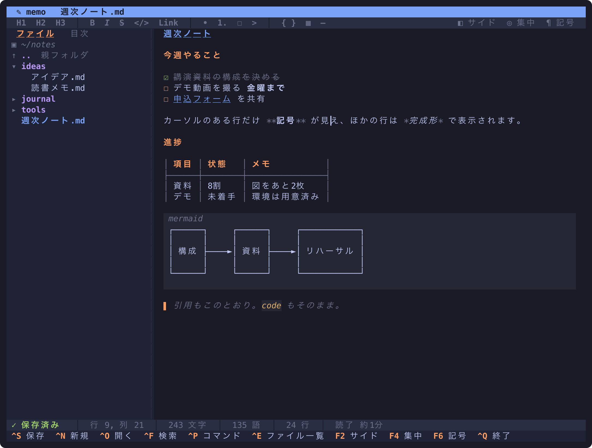

# memo

ターミナルで書く、リッチな Markdown ノートエディタ。



- **ライブプレビュー**: カーソルのある行だけ Markdown の記号を見せ、ほかの行は完成形で描きます
  (見出し・☐/☑ チェックリスト・箇条書き・引用・表・コードブロック・太字/斜体/リンク)
- **表は罫線つきで桁を揃えます**。日本語の全角幅にも対応し、画面に収まらないセルは「…」で切ります
- **Mermaid の図をその場で描きます** (flowchart / graph・sequenceDiagram・erDiagram。描画は [mermaid-ascii](https://github.com/AlexanderGrooff/mermaid-ascii))。
  コードブロックにカーソルを入れるとソースに戻ります
- **Marp のスライド**: front matter に `marp: true` があると、`---` を「スライド 2 / 5」の区切りとして描き、
  `<!-- _class: lead -->` のような指示は ⚙ で控えめに見せます。
  [marp-cli](https://github.com/marp-team/marp-cli) が入っていれば、カーソルのあるスライドを**本物の見た目の画像で右側に出します** (kitty / Ghostty。F7 で表示切替)
- ファイル一覧・目次・全文検索・コマンドパレット・自動保存・テーマ
- Markdown 以外のテキストファイルも行番号つき・色付きで開けます
- マウス対応 (クリック・ドラッグ選択・☐ のクリック・ツールバー)

## インストール

[Releases](https://github.com/Mojashi/memo/releases) から自分の OS 用のバイナリを取って PATH に置くか、Go (1.25 以上) があれば:

```sh
go install github.com/Mojashi/memo@latest
```

## 使い方

```sh
memo            # 今のフォルダを開く
memo notes/     # フォルダを開く
memo todo.md    # ファイルを開く (親フォルダが一覧に出る)
```

| キー | 操作 |
| --- | --- |
| Ctrl+S / Ctrl+N / Ctrl+O | 保存 / 新しいノート / ファイルを開く |
| Ctrl+F | 全ノートを検索 (ファイル名と本文) |
| Ctrl+P | コマンドパレット (テーマ変更もここから) |
| Ctrl+E | サイドバーへ移動 / 戻る (サイドバーで Backspace か `..` で親フォルダへ) |
| F2 / F4 / F6 | サイドバー / 集中モード (Esc でも戻る) / 記号を全部見せる |
| F7 | Marp のスライドの画像を出す / しまう |
| Ctrl+B / Ctrl+L / Ctrl+T | 太字 / リンク / チェックの切り替え |
| Ctrl+Z / Ctrl+Y | 元に戻す / やり直す |
| Option+← → (Ctrl+← →) | 単語ごとに移動 (Shift で選択) |
| Tab / Shift+Tab | 字下げ / 字下げを戻す |
| Ctrl+Q | 終了 (名前のあるノートは保存してから) |

Enter でリスト・チェックリスト・番号・引用が続きます。空の項目で Enter すると記号が消えます。

### Marp のスライドを画像で見る

```sh
npm i -g @marp-team/marp-cli   # 中で Chrome を使います
```

画像は kitty の画像表示 (Unicode プレースホルダー) で出すので、kitty か Ghostty で使えます。
tmux の中で使うときは `~/.tmux.conf` に次の1行が要ります。

```tmux
set -g allow-passthrough on
```

marp-cli に入っている marp-core と Chrome を裏で起動したままにして、入力が落ち着くたびに変わったスライドだけを描き直します (最初の1回は約1秒、その後は 0.1 秒ほど)。

## 開発

```sh
go test ./...
go run .
# README のスクリーンショットを撮り直す
MEMO_SCREENSHOT=$PWD/docs/screenshot.svg go test ./internal/ui -run Screenshot -count=1
rsvg-convert -z 2 docs/screenshot.svg -o docs/screenshot.png
```
